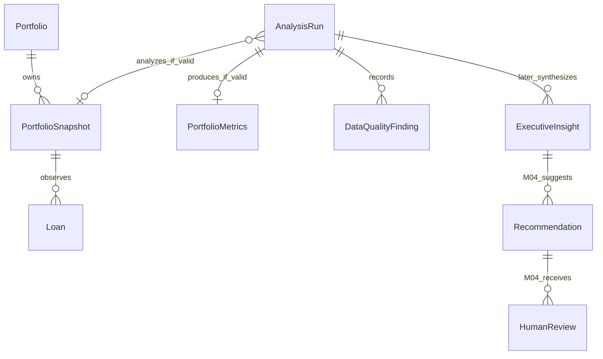

# Domain model

Status: Proposed
Version: 1.0
Last Updated: 2026-10-15

Acceptance: [BASELINE-ACCEPTANCE-001](../changes/BASELINE-ACCEPTANCE-001.md), owner approval 2026-10-15, reviewed commit archived baseline review revision. M02 aggregates/value objects, lifecycle, global identity and domain isolation are Accepted. Later entities/lifecycle/diagram relationships remain Proposed; the container remains Proposed.

## M02 aggregates and value objects
Status: Accepted
Applicability: M02

| Concept | Responsibility | Invariant |
|---|---|---|
| Portfolio | One synthetic USD collection owning snapshots. | Currency fixed; no FX. |
| PortfolioSnapshot | Complete immutable observation identified by snapshot_id. | Globally unique identity and exactly one portfolio_id owner; valid empty snapshots permitted. |
| Loan | Snapshot observation of obligation. | CT-002; unique loan_id inside snapshot. Open zero-principal loan remains in count population. |
| BorrowerRef | Synthetic customer_id grouping value. | No personal identity or separate CRUD aggregate. |
| Money / CreditExposure | Exact USD minor-unit value; exposure derived from principal. | No floating authority, no duplicate exposure source entity. |
| PortfolioMetrics | Immutable calculation with raw groups, exact operands and quantized derived values. | CT-004/017; availability by each denominator, no mandatory excluded-finance stub. |
| DataQualityFinding | Blocking contract diagnostic linked to immutable validation report. | CT-005/019; valid null segment/empty/zero population is not a defect. |
| ImportResult | Typed complete-population validation/operation outcome. | CT-015; application-assigned identity; no valid snapshot for non-valid outcome. |
| EvidenceRef | Run-scoped immutable artifact locator. | M02 CT-003 subset; no cross-run IDs or arbitrary paths. |
| AnalysisRun | Execution aggregate with input/config/code lineage and stage outcomes. | CT-011/016; Application alone changes lifecycle; terminal results immutable. |

## M02 run lifecycle
Status: Accepted
Applicability: M02

created -> running -> succeeded, rejected, conflict, limit_failed or failed. Terminal runs are immutable. A new analysis key/config deliberately creates a new run, optionally with parent_run_id. Exact same analysis key/fingerprint replays the original result, without a new successful commit.
succeeded requires valid complete input, completed deterministic calculation and durable metadata/files. A valid empty population and unavailable ratios from zero denominators can succeed. rejected means input contract defects. conflict preserves earlier identity/key bindings. limit_failed means input safety bound exceeded. failed means operational/configuration/calculation error or no durable finalization; it must not claim persistent success. If metadata storage cannot record failure, report a non-durable operation error rather than inventing a persisted run.
Interrupted running state is reconciled by CT-018, not a graph checkpoint. Restart may read verified committed results and repeat an unfinished deterministic operation; it cannot overwrite terminal payloads or corrupt references. No partial/pending_review status or AI readiness is required by M02.

## Later entities and lifecycle variants
Status: Proposed
Applicability: M03/M04; open gates apply

RiskFinding, PolicyFinding, CreditPolicy/PolicyRule and ExecutiveInsight are M03 concepts governed by their Proposed contracts. M03 insight is observations/explanations/inspection suggestions with no business-action recommendations. If later AI fails after valid metrics, retain metrics and mark requested optional stage failed/unavailable with partial result quality. Do not change valid metrics to failed merely because an optional interpretive stage failed.
Recommendation and HumanReview are M04 concepts. No M03 pending-review dependency. M04 uses provisional_quality and pending_review to preserve required human action; reviewer identity, review aggregation and checkpoint coordination remain OQ-009/012. Policy conflicts stay indeterminate and are corrected in corpus curation outside an analysis; they are not recommendation-review targets.

Relationship diagram includes Proposed later variants; invalid operations have no validated snapshot. No borrower CRUD, autonomous agent hierarchy or generic repository framework. Standard Python domain values remain independent of SQLite, Streamlit, Pydantic, providers and graph frameworks.
