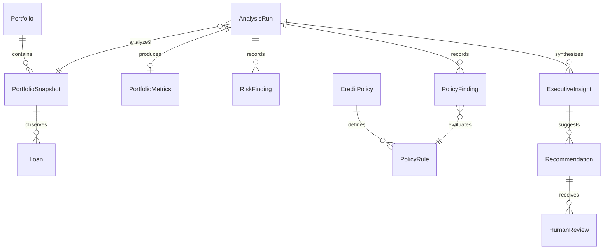

# Domain model

Status: Proposed
Version: 1.0
Last Updated: 2026-10-07

## Entities and value objects
| Concept | Responsibility and relationship | Invariant / lifecycle |
|---|---|---|
| Portfolio | Identity, label and currency; owns snapshot sequence. | Currency fixed within v1 portfolio. |
| PortfolioSnapshot | Immutable input aggregate of Loan observations, manifest and source hash. | Unique loan IDs, explicit as_of; received to validated or rejected. Never mutate an accepted snapshot. |
| Loan | Snapshot observation of a synthetic obligation. | CT-002 constraints; identity is snapshot plus loan_id. |
| BorrowerRef | Value object customer_id used for grouping. | No independent lifecycle or borrower table in v1. |
| Money | Decimal amount plus currency. | No implicit FX or float arithmetic. |
| CreditExposure | Derived value from outstanding principal. | Not an independent entity or duplicated stored source field. |
| PortfolioMetrics | Immutable computed result for snapshot and calculation version. | Denominators and unavailable reasons preserved. |
| EvidenceRef | Typed reference to source row, metric, policy chunk, or rule evaluation. | Resolvable within immutable run inputs; no unrestricted URL or arbitrary path. |
| DataQualityFinding | Input defect and source location. | Rejected records retained only as audit evidence under retention policy. |
| RiskFinding | Deterministic rule observation. | Rule version, inputs and evidence are mandatory. |
| PolicyFinding | Evaluation outcome for a curated rule. | Violation/compliant require deterministic proof and applicable source. |
| ExecutiveInsight | Validated interpretation of findings. | No authoritative numeric literals; claims link evidence. |
| Recommendation | Suggested analyst action linked to insight. | High impact defaults to pending review; never directly executed. |
| CreditPolicy / PolicyRule | Immutable policy version and reviewed predicate with source mapping. | Draft to curated; superseded versions retained for historic runs. |
| AnalysisRun | Execution aggregate joining immutable input/config with outputs and events. | Only application transitions status; revision supports concurrency control. |
| HumanReview | Append-only human decision on a specific recommendation revision. | Cannot alter original metrics, evidence, or output text. |

## Relationships

## AnalysisRun lifecycle
`created -> running -> succeeded | partial | rejected | failed | pending_review`.
`pending_review -> running -> succeeded | partial | failed` only after a valid human action and revision check. Infrastructure recovery may continue `running` from its last committed checkpoint. Terminal runs are immutable; a deliberate rerun receives a new run_id and parent_run_id.
`rejected` means input invalid. `failed` means no usable deterministic result or durable finalization failed. `partial` means deterministic results exist but a requested optional analysis or AI stage is unavailable/failed. `succeeded` means all requested stages completed; optional stages not requested are explicitly not_requested. `pending_review` is nonterminal and records the provisional result quality separately. Human rejection changes recommendation visibility, not deterministic result quality.
The application records stage outcomes and completeness; graph topology alone does not decide domain success.

## Simplifications
No Borrower CRUD, exposure entity, autonomous agent hierarchy, or generic repository framework. Dataclasses/enums can represent the domain later. Pydantic belongs at boundaries; domain objects do not inherit provider or orchestration state classes.
