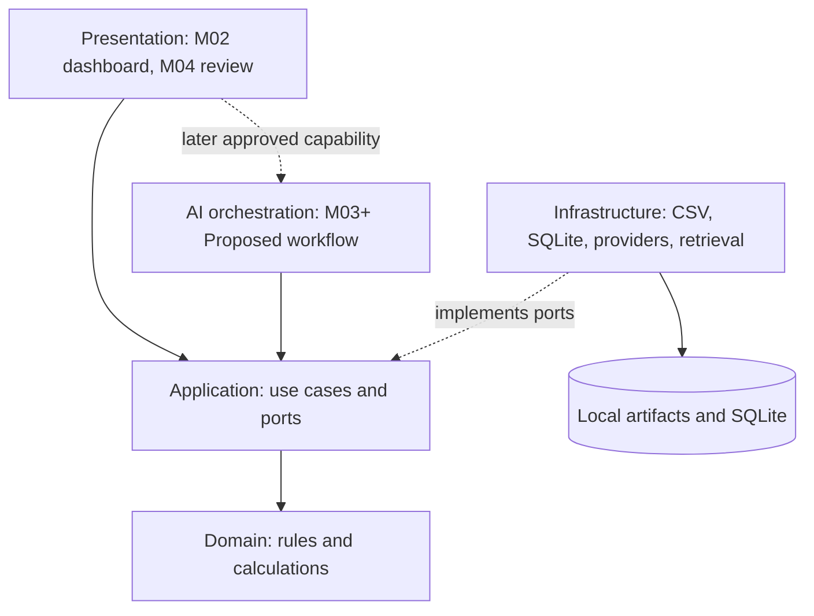

# System architecture

Status: Proposed
Version: 1.0
Last Updated: 2026-10-15

Acceptance: [BASELINE-ACCEPTANCE-001](../changes/BASELINE-ACCEPTANCE-001.md), owner approval 2026-10-15, reviewed commit archived baseline review revision. Accepted: local modular single-process boundary, M02 presentation/application/domain/infrastructure ownership, M02 persistence/publication and direct Streamlit adapter direction. Proposed: graph/checkpointer/node recovery, provider/retrieval/review ports and runtime extensions. Container remains Proposed.

## Deployment and boundaries
One local Python process with presentation, application use cases, pure domain calculations, infrastructure adapters and optional graph orchestration. No separate API server, distributed queue or agent supervisor. ADR-001 through ADR-008 record alternatives and status.

| Component | Owns | Must not own |
|---|---|---|
| CMP-PRESENTATION | Rendering, import interaction, question input, explicit human actions. | Formulas, policy decisions or direct provider calls. |
| CMP-APPLICATION | Use cases, transactions, run transitions, scope checks, ports. | Framework-specific UI or provider response types. |
| CMP-DOMAIN | Values, invariants, financial calculations and rule predicates. | Filesystem, SQL, HTTP, framework imports or prompts. |
| CMP-INFRASTRUCTURE | Parsing, SQLite, artifacts, provider/retrieval adapters, logging. | Business semantics or unreviewed defaults. |
| CMP-GRAPH | Sequencing, retries, checkpoint coordination, interrupt/resume. | Numeric authority or unrestricted agents. |

Future ports: SnapshotStore, RunStore, EvidenceStore, PolicyRetriever, StructuredModel, ReviewStore. Introduce each only when a slice uses it. Composition lives outside domain. tools/ contains narrow adapters over application operations rather than duplicate logic. Domain uses standard Python types/dataclasses; Pydantic may validate boundaries after ADR-002 acceptance.

## Persistence and SQL
Status: Proposed
Applicability: M02 core; graph extension remains Proposed

Owner decisions select local SQLite metadata and immutable artifact files with one writer for v1; ADR-003 is Accepted under BASELINE-ACCEPTANCE-001 for its recorded local direction; later details remain gated. M02 run/import/event records and restart behavior follow CT-015/016/018/019. Review/checkpoint records belong to later slices, not M02. Use parameterized queries, foreign keys, unique idempotency keys and revision checks. Graph checkpoints are a later technical store separate from audit metadata. No graph checkpointer is required in M02. The .risklens/state root and stopped-application whole-state cleanup are specified in CT-018.

M02 publishes verified immutable files before one SQLite metadata transaction under CT-018; no cross-store atomicity or automatic orphan collection is claimed. Global snapshot_id ownership and import/analysis fingerprint bindings are transactional. The following graph recovery direction remains Proposed under OQ-009/ADR-001, and is not an M02 implementation contract.

Node output uniqueness is `(run_id, node_id, input_hash, config_hash)`. If a crash occurs after result commit but before checkpoint commit, recover by reading the committed result and advancing the checkpoint. Never checkpoint an uncommitted reference. Do not promise exactly-once external model invocation. Test schema migrations and incompatible checkpoints before completing persistence work.

## Incremental adoption
Status: Proposed
Applicability: M02; future graph/provider variants Proposed

M02 uses Streamlit as a presentation adapter calling Application directly. Calculations and durable state never exist only in callbacks; UI reruns use CT-016 replay keys. No graph/provider dependency is installed for M02. M03 may introduce LangGraph for justified resume/branching after ADR-001 and its readiness gates are accepted. LangChain may support retrieval/provider adapters behind ports; a direct SDK remains an alternative when simpler. No runtime dependency is installed in this baseline.

SQLite serializes writes; the initial model has one local writer. UI reruns must not restart work without idempotency keys. Schema validation alone does not establish factual truth; semantic grounding requires evals and review. Deployment, tenancy and advanced policy languages remain outside scope.
