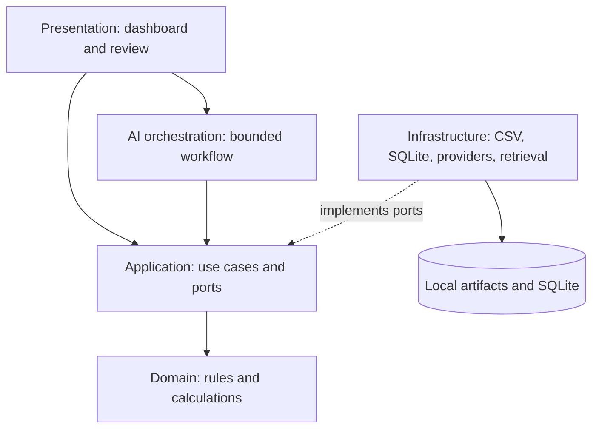

# System architecture

Status: Proposed
Version: 1.0
Last Updated: 2026-10-07

## Deployment and boundaries
One local Python process with presentation, application use cases, pure domain calculations, infrastructure adapters and optional graph orchestration. No separate API server, distributed queue or agent supervisor. ADR-001 through ADR-008 record alternatives and status.

| Component | Owns | Must not own |
|---|---|---|
| CMP-PRESENTATION | Rendering, import interaction, question input, explicit human actions. | Formulas, policy decisions or direct provider calls. |
| CMP-APPLICATION | Use cases, transactions, run transitions, scope checks, ports. | Framework-specific UI or provider response types. |
| CMP-DOMAIN | Values, invariants, financial calculations and rule predicates. | Filesystem, SQL, HTTP, framework imports or prompts. |
| CMP-INFRASTRUCTURE | Parsing, SQLite, artifacts, provider/retrieval adapters, logging. | Business semantics or unreviewed defaults. |
| CMP-GRAPH | Sequencing, retries, checkpoint coordination, interrupt/resume. | Numeric authority or unrestricted agents. |

Future ports: SnapshotStore, RunStore, EvidenceStore, PolicyRetriever, StructuredModel, ReviewStore. Introduce each only when a slice uses it. Composition lives outside domain. tools/ contains narrow adapters over application operations rather than duplicate logic. Domain uses standard Python types/dataclasses; Pydantic may validate boundaries after ADR-002 acceptance.

## Persistence and SQL
ADR-003 proposes SQLite for run/review/event metadata and content-addressed local files for snapshots/results. Use parameterized queries, foreign keys, unique idempotency keys and revision checks. Graph checkpoints are technically separate from the domain audit record even if both use SQLite.

Node output uniqueness is `(run_id, node_id, input_hash, config_hash)`. If a crash occurs after result commit but before checkpoint commit, recover by reading the committed result and advancing the checkpoint. Never checkpoint an uncommitted reference. Do not promise exactly-once external model invocation. Test schema migrations and incompatible checkpoints before completing persistence work.

## Incremental adoption
M02 calls Application directly without graph/provider dependencies. M03 introduces LangGraph for justified resume and branching needs. LangChain may support retrieval/provider adapters behind ports; a direct SDK remains an alternative when simpler. No runtime dependency is installed in this baseline.

SQLite serializes writes; the initial model has one local writer. UI reruns must not restart work without idempotency keys. Schema validation alone does not establish factual truth; semantic grounding requires evals and review. Deployment, tenancy and advanced policy languages remain outside scope.
