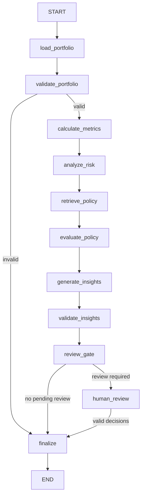

# Graph specification

Status: Proposed
Version: 1.0
Last Updated: 2026-10-07

## Design
Use a bounded workflow, not a planner loop. The suggested linear flow omitted invalid-data routing, AI output validation, durable finalization and a genuinely paused review state. Risk detection and policy evaluation are deterministic. Only interpretation uses a model. Copilot is a separate read-only path over existing runs.

The diagram shows the full requested path. Error and not_requested branches are defined below. If policy analysis is not requested, both policy nodes are not_requested. If synthesis is not requested, both synthesis nodes are not_requested. Requesting policy evaluation requires retrieval; invalid combinations are rejected before execution.

## GraphState and universal node rules
Versioned state contains run_id, expected_revision, immutable input/config hashes, requested stages, node status map, errors, provisional_quality and the artifact references listed below. No unvalidated mutable metric dictionaries or full corpus. Nodes return allowlisted patches; Application validates and commits them atomically. Sequential writes suffice; no parallel reducers.

Every committed node output receives a durable checkpoint keyed to run_id and schema version. Checkpoint references and hashes, not secrets. Replay checks persisted idempotency keys before effects. Pure nodes have no retry. Transient I/O/model retries require explicit max_attempts, timeout and total budget from approved OQ-008 configuration. Unresolved values block the slice rather than allowing unlimited attempts. Record every attempt. Interrupts are control flow, not retryable errors.

Accepted outputs are immutable. AI candidates remain separate until validation. Recovery reads committed results if checkpoint advancement was interrupted. Canonical run lifecycle is in domain-model.md. RunStore failure may leave the last durable status running; recovery reconciles it and UI must not claim success.

## Node contracts
All rows inherit checkpoint and budget rules above. Fields in the Writes column are the only allowed state mutations, besides node status/error events. Each node commits validated output references before checkpoint advancement. Dependencies are accessed through Application unless explicitly pure Domain.

| Node | Responsibility | Input | Output / Writes | Dependencies | Errors and retry | Transition | Acceptance |
|---|---|---|---|---|---|---|---|
| load_portfolio | Resolve immutable input. | Manifest and snapshot ref. | Parsed input / input_ref. | SnapshotStore and parser. | Unreadable input or hash mismatch: no retry; bounded transient storage retry. | Readable to validate_portfolio; invalid to finalize rejected. | AC-DQ-001 |
| validate_portfolio | Validate contracts and invariants. | Parsed CT-001/002. | CT-005 and report / validation_ref. | Domain validators. | input_invalid; no retry. | Valid to calculate_metrics; invalid to finalize rejected. | AC-DQ-002 |
| calculate_metrics | Compute authoritative values. | Valid snapshot and config. | CT-004 / metrics_ref. | Domain calculators. | Invalid config/invariant; no retry. | Success to analyze_risk; failure to finalize failed. | AC-RISK-001 |
| analyze_risk | Evaluate detectors and comparison. | Metrics, snapshots, detector config. | CT-006 and status / risk_ref, comparison_ref. | Domain, SnapshotStore. | Missing config/history: unavailable, no retry. | Policy requested to retrieve_policy; otherwise skip both policy nodes and continue to synthesis or review_gate. | AC-RISK-002/003 |
| retrieve_policy | Retrieve applicable versioned sources. | Findings/query, scope, as_of, corpus. | CT-010 / retrieval_ref. | PolicyRetriever. | Timeout: bounded transient retry; absent corpus/evidence: unavailable. | Always evaluate_policy, including insufficient evidence. | AC-POL-001 |
| evaluate_policy | Apply curated predicates. | CT-010, CT-009, metrics. | CT-007 / policy_ref. | Domain, EvidenceStore. | Conflict/unsupported rule/missing input: indeterminate; no retry. | Synthesis requested to generate_insights; otherwise review_gate. | AC-POL-002 |
| generate_insights | Produce candidate interpretation. | Frozen metrics/findings/evidence. | Candidate CT-008 / candidate_ref only. | StructuredModel. | Timeout: bounded retry; exhausted budget or invalid candidate: no loop. | Candidate to validate_insights; failure to review_gate with partial quality. | AC-AI-001 |
| validate_insights | Validate schema, claims, references and action limits. | Candidate and evidence allowlist. | Accepted CT-008 or rejection / insights_ref only on acceptance. | Application validator, EvidenceStore. | Invalid/unsupported output: discard, no automatic repair. | review_gate with accepted output or partial quality. | AC-AI-001 |
| review_gate | Assign impact and required review. | Validated outputs and completeness. | Request / review_request_ref, provisional_quality. | Application BR-POL-004. | Invariant failure: no retry, finalize failed. | Pending high impact to human_review; otherwise finalize. | AC-AI-003 |
| human_review | Pause and accept explicit human decisions. | Request and CT-012 resume. | Append-only record / review_ref, expected_revision. | ReviewStore, interrupt adapter. | Invalid/stale input stays pending; transient persistence retry bounded. | Remain paused until all required decisions; then finalize. | AC-AI-003 |
| finalize | Persist status and outputs. | Stage outcomes, metrics availability, reviews. | CT-011 / status, completed_at, revision. | RunStore transaction, event adapter. | Persistence failure: bounded idempotent retry; no false success. | Durable terminal result to END. | AC-OBS-001/002 |

human_review additionally persists the pending request before interrupt and tolerates node replay before that interrupt. Pending review is not END. A human rejection marks recommendations rejected; it does not erase metrics or prove the analysis failed.

## Resume verification
AC-OBS-002 applies to every node. Inject crashes before result commit, after result commit and after checkpoint commit. Repeat review actions with the same key/revision. Never place non-idempotent effects before an interrupt without a committed-result lookup. Changed prompts, rules, contracts or incompatible checkpoint code require a new run. Provider calls may repeat after ambiguous failures; committed outputs must not duplicate.

References consulted 2026-10-07: [LangGraph persistence](https://docs.langchain.com/oss/python/langgraph/persistence) and [interrupts](https://docs.langchain.com/oss/python/langgraph/interrupts). These support the persistence and replay precautions. Exact package versions are selected and locked in the approved implementation slice.
